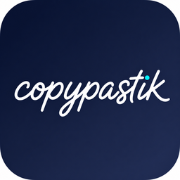

<p align="center">
  
</p>

<h1 align="center">Copypastik</h1>

<p align="center">
  A fast, local-first macOS menu bar clipboard history app for text and images.
</p>

<p align="center">
  <a href="https://github.com/andriivanchenko/Copypastik/releases/latest">
    
  </a>
  
  
  
</p>

<p align="center">
  <a href="https://github.com/andriivanchenko/Copypastik/releases/latest"><strong>Download the latest DMG</strong></a>
  ·
  <a href="#features">Features</a>
  ·
  <a href="#privacy">Privacy</a>
  ·
  <a href="#build-from-source">Build from source</a>
</p>

Copypastik keeps a small, searchable clipboard history in your menu bar, then lets you copy any saved text or image back to the system clipboard with a keyboard-first floating picker. Use the default `Control + Option + V` shortcut, switch to `Command + Shift + V` from Settings, and keep the whole workflow private on your Mac.

## Download

Grab the latest `.dmg` from the [Releases page](https://github.com/andriivanchenko/Copypastik/releases/latest).

1. Download `Copypastik.dmg`.
2. Open it.
3. Drag `Copypastik.app` into `Applications`.
4. Launch Copypastik from Applications.

Copypastik does not require permission for clipboard history or the global picker shortcut. Automatic Paste is optional; when enabled, macOS requires you to allow Copypastik in System Settings before the app can post Command-V to the previous app. Copypastik never triggers a system permission prompt.

## Features

- **Instant picker**: press `Control + Option + V` by default to open a floating clipboard picker above the current app.
- **Text and image history**: stores copied plain text and bitmap images, kept locally between launches (can be switched to memory-only in Settings).
- **Tagged snippets**: add tags with `Command + T` to keep selected text or image snippets permanently on this Mac.
- **Smart deduplication**: copying an existing item moves it back to the top instead of creating duplicates.
- **Fast search**: filter clipboard history in real time, including `#tag` filters for tagged snippets.
- **Keyboard-first workflow**: navigate with arrows, copy the selected item with Enter, close with Esc.
- **Inline deletion**: reveal and remove individual items without clearing the full history.
- **Plain-text paste**: text is pasted without rich formatting, fonts, or copied file payloads.
- **Menu bar native**: no Dock icon, no extra window clutter, no external dependencies.
- **Optional launch at login**: enable automatic startup from Settings when you want it.
- **Configurable shortcut**: switch the picker shortcut to `Command + Shift + V` from Settings.
- **Optional automatic paste**: off by default; enable it in Settings if you want selected items pasted into the previous app. If access is missing, Copypastik explains where to enable it and still lets you paste manually.
- **Paste hint**: when Automatic Paste is off or unavailable, a brief nonactivating hint reminds you to press `Command + V`.
- **Configurable history size**: keep 20, 50, 100, 250, or 500 clipboard items.
- **Polished details**: native material, semantic row icons, image thumbnails, reduced-motion support, and a compact menu bar history view.

### Smart Recall (1.3)

- **Source app tracking**: each clip remembers the app it was copied from (e.g. "Safari · 2 min ago"), shown with the app's icon on its row.
- **`@app` search**: type `@Safari`, `@Xcode`, `@Slack`, etc. to filter by source app name or bundle id.
- **Type filter chips**: `All / Text / Links / Images / Code / Commands` chips filter the list; the same filters work as `type:image`, `type:link`, `type:code`, `type:command`, `type:text` in search.
- **Combined query syntax**: filters stack with AND semantics, e.g. `@Xcode type:code`, `type:image #design`, `@Safari type:link apple`.
- **Pinned clips**: press `Command + P` to pin/unpin the selected clip. Pinning automatically assigns the lowest free Quick Slot (1–9), shown as a `⌃⌥N` badge right on the card. Pinned clips need no tag, keep a stable slot order, and persist locally between launches even if removed from history.
- **Quick Slots 1–9**: trigger a pinned clip from anywhere with `Control + Option + 1`…`9` — it is copied (and pasted, if Automatic Paste is on) instantly; otherwise a toast confirms the clip is on the clipboard ready for `Command + V`. Reassign slots with `Command + 1`…`9` in the picker. An empty slot opens the picker instead of failing silently.
- **Privacy controls**: pause capture for 5 minutes, 30 minutes, or until resumed (menu bar shows the paused state and a Resume action), and maintain an ignored-apps list — pre-seeded with common password managers — so their clipboard contents are never captured.

### Power Library (1.4)

- **Library window**: a normal, resizable macOS window for browsing and managing the whole history. Open it from the menu bar (`Open Library`, or the Library button in the menu bar popover), with `Control + Option + L`, or with `Command + L` inside the picker. Reopening focuses the existing window. The picker stays the fastest path for pasting; the Library is the deep workspace.
  - Sidebar: *All Clips*, *Pinned*, *Apps*, *Types*, *Tags*, each with counts. Sidebar selections combine (AND) with search.
  - List: grouped into Pinned / Today / Yesterday / Previous 7 Days / Earlier, with source-app icons, thumbnails, link domains, code previews, tags, pin and Quick Slot badges.
  - Detail panel: full text/image preview, metadata (source app, type, size, capture time, tags, Quick Slot), Quick Slot assignment, and recognized text for images.
  - Search uses the same syntax as the picker: plain text, `#tag`, `@app`, `type:image|link|code|command|text`. `Return` copies the selection (and pastes into the previous app when Automatic Paste is on); `Esc` clears the search, then a multi-selection, then closes the window.
- **Local OCR for images**: text in copied screenshots and images is recognized on-device with Apple Vision (never uploaded), runs in the background so capture and the picker never wait, is stored with the clip, and is searchable in both the Library and the picker. The Library shows a discreet "Recognizing text…" state and a **Copy Recognized Text** action. Turn it off with *Recognize Text in Images* in Settings.
- **Bulk actions** (Library only): select with click, `Shift`-click ranges, `Command`-click toggles, `Shift + Up/Down`, or `Command + A`. A compact bar offers **Copy Selected**, **Pin/Unpin**, **Tag** (add/remove) and **Delete**.
  - Copy Selected joins the text of the selected text clips with a newline, in list order. Images are skipped and reported; it is unavailable when no text clip is selected.
  - Deleting more than one clip, or any pinned clip, asks for confirmation. *Delete* keeps pinned clips (and their Quick Slots); *Delete Everywhere* removes them too and is offered only when pinned clips are selected.
  - Actions only affect the selected clips. Selected clips that leave the list (for example after changing the filter) are deselected first.
- **Drag & drop**: drag a row, or the detail preview, into another app. Text drags as plain text, links as a URL with a plain-text fallback, and images as PNG (both as image data and as a file). Whether a destination accepts the file form (for example a Finder folder) is up to that app.
- **Smart transformations** (Library context menu and the detail panel's *Transform* menu): Paste as Plain Text, Trim Whitespace, Uppercase, Lowercase, Pretty Print JSON (sorted keys), URL Decode, URL Encode, Remove URL Tracking Parameters, Copy Domain from URL, Normalize Line Breaks. Transforms never change the original clip; the result is copied to the clipboard without being added to history. Transforms that obviously cannot apply are disabled, and malformed JSON or percent-encoding shows a short inline message.
  - Tracking removal is deliberately conservative: it drops `utm_*`, `fbclid`, `gclid`, `gclsrc`, `dclid`, `msclkid`, `twclid`, `yclid`, `igshid`, `mc_cid`, `mc_eid`, `_hsenc`, `_hsmi` and `mkt_tok` from a whole-text http(s) link and leaves every other byte alone.
  - Copy Domain returns the host with a leading `www.` removed.

## How It Works

| Action | Shortcut or control |
|---|---|
| Open picker | `Control + Option + V` by default; switch to `Command + Shift + V` in Settings |
| Search history | Type in the search field — supports plain text, `#tag`, `@app`, and `type:` filters |
| Filter by type | Click a type chip (`All/Text/Links/Images/Code/Commands`) or type `type:image` etc. |
| Tag selected item | `Command + T`, then enter comma-separated tags |
| Reveal tag filters | Press `Up` from the first row, then use `Left` / `Right` to switch `All` and tags |
| Change tag color | Right-click a tag chip and choose a pastel color |
| Pin / unpin selected item | `Command + P`, or click the pin icon on a row — pinning auto-assigns the next free Quick Slot |
| Reassign a pinned item's Quick Slot | `Command + 1`…`9` while the pinned item is selected |
| Paste a Quick Slot from anywhere | `Control + Option + 1`…`9` (the slot is shown as `⌃⌥N` on the card) |
| Move selection | `Up` / `Down` |
| Copy selected item to clipboard | `Enter`; then paste in the target app with `Command + V` |
| Automatically paste selected item | Enable `Automatic Paste` in Settings, allow Copypastik in System Settings if needed, then press `Enter` |
| Reveal delete action | `Left` on selected row, or right-click |
| Delete revealed item | `Left` again, or click the trash button |
| Hide delete action | `Right`, change selection, or continue typing |
| Close picker | `Esc` or click outside |
| Clear all history | Picker trash button, or Settings -> `Clear History` |
| Manage tagged snippets | Right-click the menu bar icon -> `Snippets` |
| Pause / resume capture | Right-click the menu bar icon -> `Pause Capture` / `Resume Capture` |
| Open the Library | Right-click the menu bar icon -> `Open Library`, `Control + Option + L`, or `Command + L` in the picker |
| Library: move / extend selection | `Up` / `Down`, `Shift + Up/Down`, `Command + A`, or click / `Shift`-click / `Command`-click |
| Library: copy selection | `Return` (several text clips are joined with newlines) |
| Library: pin, tag, Quick Slot | `Command + P`, `Command + T`, `Command + 1`…`9` |
| Library: delete | `Delete` outside the search field, or `Command + Delete` (asks first for several or pinned clips) |
| Library: focus search / close | `Command + F` / `Esc` or `Command + W` |

After selection, Copypastik copies the item back to the clipboard and returns focus to the previous app when possible. Paste manually with `Command + V`, or enable Automatic Paste in Settings for the optional one-step workflow.

## Privacy

Copypastik is intentionally local and small.

- Clipboard history is saved locally in the app's Application Support storage so the Library survives relaunches. It is bounded by the history-size setting (text clips over 256 KB stay memory-only; image history is capped at 96 MB). Turn off *Keep History Between Launches* in Settings to go back to memory-only history; doing so deletes the saved file.
- Tagged snippets and pinned clips are stored locally in Application Support because the user explicitly chose to keep them.
- Clips captured while capture is paused, or from ignored apps, are never recorded or saved. Adding an app to the ignored list also removes its existing history.
- Image text recognition uses Apple's Vision framework on-device; images and recognized text never leave your Mac.
- Clear History removes the saved history file as well.
- No account, cloud sync, analytics, or network service is used.
- Rich text, files, and mixed clipboard payloads are ignored.
- The global picker and Quick Slot shortcuts use Carbon `RegisterEventHotKey`; Copypastik does not monitor general keyboard input.
- Automatic Paste posts only Command-V through Core Graphics after a user selects an item and the existing permission state is already granted. If access is missing, Copypastik copies the item, returns focus, and shows the manual paste hint.
- Capture can be paused (5 min / 30 min / until resumed) from the menu bar, and an ignored-apps list — pre-seeded with common password managers (Passwords, 1Password, Keychain Access, and similar) — keeps their clipboard contents out of history entirely. The list is visible and editable in Settings.

## Requirements

- macOS 14 or later
- No permission required for clipboard history or the global picker shortcut
- Optional Automatic Paste requires allowing Copypastik in System Settings
- Xcode 16 or later if building from source (project uses `PBXFileSystemSynchronizedRootGroup`)

## Build From Source

Clone the repository and open the Xcode project:

```bash
git clone https://github.com/andriivanchenko/Copypastik.git
cd Copypastik
open Copypastik.xcodeproj
```

Select the `Copypastik` scheme, then press `Run`.

You can also build from the command line without signing:

```bash
DEVELOPER_DIR=/Applications/Xcode.app/Contents/Developer \
xcodebuild build \
  -project Copypastik.xcodeproj \
  -scheme Copypastik \
  -destination 'platform=macOS' \
  -derivedDataPath /tmp/CopypastikDerivedData \
  CODE_SIGNING_ALLOWED=NO
```

## Create a DMG

The repository includes a packaging script for a standard macOS drag-to-Applications DMG:

```bash
DEVELOPER_DIR=/Applications/Xcode.app/Contents/Developer scripts/package_dmg.sh
```

The output is written to:

```text
dist/Copypastik.dmg
```

You can also package an existing app bundle:

```bash
APP_PATH=/path/to/Copypastik.app scripts/package_dmg.sh
```

## Architecture

```text
CopypastikApp.swift          App entry point, MenuBarExtra scene, launch-at-login setup
AppCoordinator              Owns long-lived services
|
+-- ClipboardStore          Typed history, recency dedup, deletion, configurable item cap, pin/slot API,
|   |                       merged Library view, bulk actions, OCR queue
|   +-- PasteboardService   Polls NSPasteboard.changeCount every 0.5 seconds
|   +-- SourceAppTracker    Tracks the last non-Copypastik foreground app for source-app attribution
|   +-- HistoryStore        Persists bounded clipboard history (+ images, OCR text) to Application Support
|   +-- TaggedStore         Persists tagged snippets to JSON in Application Support
|   +-- PinnedStore         Persists pinned clips (+ Quick Slot) to JSON in Application Support
|   `-- TextRecognizer      Apple Vision OCR, run off the main thread
|
+-- AppSettings             User preferences: tag colors, capture pause state, ignored apps list
|
+-- HotkeyService           Carbon global hotkey registration for the picker shortcut
+-- QuickSlotHotkeyService  Carbon global hotkeys for Control+Option+1...9 Quick Slots
+-- LibraryHotkeyService    Carbon global hotkey (Control+Option+L) that opens the Library
|
+-- LibraryWindowController Single Library NSWindow, key routing, paste-into-previous-app
|   +-- LibraryState        Sidebar scope, search, selection, bulk actions, status (testable view model)
|   +-- LibraryFilter       Pure scope + search filtering, date grouping, sidebar counts
|   +-- LibraryView         Sidebar / list / detail SwiftUI views
|   +-- LibraryDragProvider NSItemProvider exports for text, links and images
|   `-- ClipTransform       Non-destructive text transformations
|
`-- PickerWindowController  Floating panel, keyboard routing, outside-click dismiss, copy / optional paste
    `-- ClipboardPickerView Search field, type chips, pinned/tagged/history sections, tag editor row
```

## Design Notes

- `NSPasteboard` has no change notification API, so clipboard changes are detected by polling `changeCount`.
- `RegisterEventHotKey` captures the selected picker shortcut and the nine Quick Slot shortcuts without leaking keystrokes into the active app.
- `LSUIElement` keeps the app menu-bar-only while preserving native SwiftUI menu bar behavior.
- Selection confirmation is guarded so one Enter press results in one clipboard write, plus optional automatic paste when enabled.
- Image clipboard items are normalized to bitmap data and displayed with compact metadata.
- Self-written pasteboard changes are suppressed so selecting an item does not duplicate it in history.
- Tagged snippets are separate from the transient history: tagging moves an item out of history and into a persistent JSON store, and copying a tagged snippet does not re-add it to history.
- Tag colors are stored per normalized tag name in `UserDefaults`; the `TagColor` enum provides seven palettes with automatic assignment via FNV hash as a fallback.
- `SourceAppTracker` watches `NSWorkspace.didActivateApplicationNotification` rather than reading `frontmostApplication` at poll time, so Copypastik's own picker/menu never gets misattributed as a clip's source app.
- Pinned clips live in their own persistent store (mirroring `TaggedStore`'s JSON + image-file approach) and are hidden from their original history/tagged row while pinned, so the same clip never renders twice.
- The Library merges history, tagged and pinned stores into one entry per distinct clip (`ClipboardStore.mergedLibraryItems`): tags come from the tagged copy, pin state and Quick Slot from the pinned copy. Pinned copies' tags are kept in sync when tags change.
- While the Library window is open, the `LSUIElement` app switches to a regular activation policy (Dock icon and menu bar) so the window behaves like a normal macOS window, and switches back when it closes.
- OCR jobs run one at a time on a background queue; results are applied to every copy of the image and saved with it. A failed recognition leaves the image fully usable.
- History is saved with a short debounce and flushed on quit; image files are written once per capture and orphaned files are removed on save.
- The unified search parser (`PickerSearchQuery`) tokenizes `#tag`, `@app`, and `type:` filters alongside plain text; all filters combine with AND semantics and match case-insensitively.

## Tests

Run the focused unit test target:

```bash
DEVELOPER_DIR=/Applications/Xcode.app/Contents/Developer \
xcodebuild test \
  -project Copypastik.xcodeproj \
  -scheme Copypastik \
  -destination 'platform=macOS' \
  -derivedDataPath /tmp/CopypastikDerivedDataTests \
  CODE_SIGNING_ALLOWED=NO \
  -only-testing:CopypastikTests \
  -skip-testing:CopypastikUITests
```

The full scheme includes placeholder UI tests, which may require local signing and UI test setup before they run end to end.
